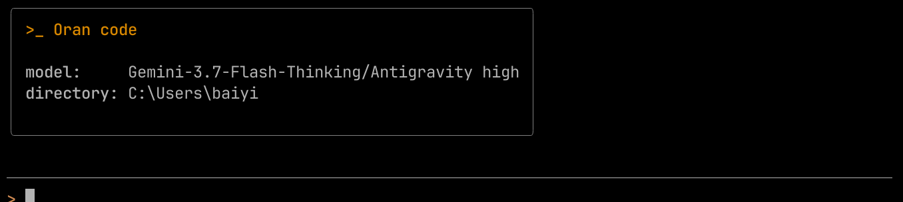

<h1 align="center">Oran Code</h1>

<p align="center">
  <a href="README.md">English</a> | <a href="README.zh-CN.md">简体中文</a>
</p>

<p align="center">
  <strong>A terminal coding agent with its own loop, its own permission gate, and its own context budget.</strong>
</p>

<p align="center">
  
  
  
  
</p>

<p align="center">
  <em>Status: v0.1.0, early development. CLI flags and configuration keys may change.</em>
</p>

<p align="center">
  
</p>

Oran Code works on a real repository from your terminal: it explores code, edits files, runs
commands, and keeps going across tool-call rounds. The agent loop, provider adapters, command
parser, and context manager are implemented in this repository rather than delegated to an
agent framework, so every step is readable, replaceable, and testable.

## Why Oran Code

Oran is for people who want to read and change the loop. The parts that decide what runs are
small enough to audit.

- **One event stream over two protocols.** OpenAI returns tool-call arguments in indexed
  fragments; Anthropic returns them as content blocks. Concatenating them in arrival order
  misaligns arguments, and provider error events can look like a normal finish. Oran adapts
  both into one internal event stream — including cross-chunk buffering, UTF-8 tail bytes, and
  a missing final separator — so the layers above never branch on provider.
- **Commands are parsed, not pattern-matched.** Before execution, shell input is tokenized
  into an AST and each pipeline stage is checked against the allowlist. Quoting tricks,
  interpreter pipes such as `... | sh`, and `rg --pre` are handled at the parse layer. Rules
  cannot cover everything, so edits also get snapshots and a disposable Git worktree as a
  backstop.
- **Context is budgeted by protocol structure.** Tool calls and results stay paired 1:1.
  Large outputs are written to disk with a bounded preview, old rounds are compacted into a
  structured summary, and the next request is assembled from what the model still needs to
  decide — not from the longest string that fits.
- **Subagents are isolated, not just concurrent.** Slow searches and multi-file exploration
  run in background subagents with their own context and tool permissions, and return a
  structured result to the main loop.

## Features

- **Terminal UI (React/Ink)** — streaming reasoning, collapsible tool output, a `/` command
  palette, model switcher, and session list.
- **Provider-agnostic** — OpenAI-compatible Chat Completions and Anthropic Messages; works
  with DeepSeek, Gemini, Ollama, and any custom endpoint.
- **Safe by default** — plan mode is read-only; risky commands ask first; `/undo` restores the
  last batch of file changes; exploratory work can run in a throwaway worktree.
- **Background subagents** — three built-in roles (`general`, `plan`, `explore`) plus custom
  definitions in `~/.oran/agents/` and `.oran/agents/`.
- **MCP, Skills, AGENTS.md** — connect MCP servers, load `SKILL.md` capability packs, and
  inject project rules automatically.
- **Scriptable** — `oran run` is non-interactive and writes a structured `oran-event/1` JSONL
  log with stable exit codes, so the same binary can run in CI or inside an evaluation harness.

## Quickstart

Requires Node.js >= 22.5 and pnpm >= 10.

```bash
git clone https://github.com/baiyi115/Oran-code.git
cd "Oran-code"
pnpm install
pnpm build
pnpm start
```

On first launch, run `/connect` to add a provider and API key, then give it a task:

```text
> Find why the pagination test fails, fix it, and run the test suite.
```

Oran reads files, proposes edits, asks before risky commands, and stores the session under
`.oran/`. Use `/undo` to revert the last batch, or `/tasks` to inspect background subagents.

## How it works

```text
prompt
  -> controller loop ──> provider adapter (OpenAI / Anthropic) ──> internal events
  -> tool scheduler ──> permission gate ──> snapshot / worktree ──> workspace
  -> context manager (pairing, offload, compaction) ──> next request
```

Each turn is a loop, not a fixed workflow: the model chooses the next tool, the permission
gate decides whether it may run, and the context manager decides what the next request keeps.
Sessions and traces live under `.oran/`; memory notes live under `~/.oran/memory/`.

## Evaluation

The evaluation harness treats "done" as an environment fact, not as the agent's claim: a task
passes only when protected paths are unchanged, verification commands pass, and a hidden
verifier passes. Failures are classified — setup, timeout, protected-path change,
verification, hidden verifier — instead of collapsed into one number.

The harness and its baseline are not yet on `main`. When they land, this section will report
the task set, model and commit, number of trials, pass rate, cost, and failure breakdown, with
the raw JSONL kept in the repository.

## Limitations and non-goals

- **Not a sandbox.** Worktrees separate working copies; they do not isolate processes,
  networks, or access to host files. Run Oran only on repositories you are willing to let an
  agent modify.
- **Local, single-user.** There is no multi-tenant server, remote execution, or hosted
  workspace.
- **No published benchmark claim.** Oran is not compared against SWE-bench or Terminal-Bench;
  any number in this repository comes from its own task set, under the stated conditions.
- **Feature scope.** It is not trying to match the feature set of Claude Code, Cursor, or
  Codex. If you want a hosted, fully supported product, use one of those.

## Documentation

- [Usage: CLI, headless mode, shortcuts, configuration, subagents](docs/usage.md)

## Development

```bash
pnpm typecheck   # TypeScript
pnpm test        # Vitest
pnpm lint        # ESLint
pnpm build       # production CLI
pnpm coverage    # coverage report
```

CI runs format check, lint, typecheck, build, and coverage on every push and pull request.

## License

Apache-2.0
