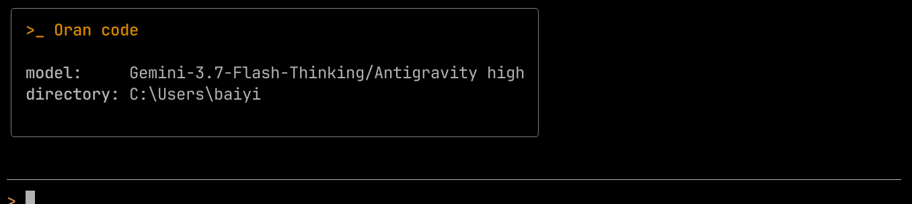

<h1 align="center">Oran Code</h1>

<p align="center">
  <a href="README.md">English</a> | <a href="README.zh-CN.md">简体中文</a>
</p>

<p align="center">
  <strong>一个自带循环、权限判定和上下文预算的终端编程 Agent。</strong>
</p>

<p align="center">
  
  
  
  
</p>

<p align="center">
  <em>状态：v0.1.0，早期开发中，CLI 参数与配置键可能变化。</em>
</p>

<p align="center">
  
</p>

Oran Code 在终端里直接处理真实仓库：读代码、改文件、执行命令，并在多轮工具调用中继续推进。Agent 循环、模型协议适配、命令解析和上下文管理都在本仓库实现，没有交给 Agent 框架，因此每一步都可以读、可以替换、可以测试。

## 为什么要有 Oran Code

如果你想要开箱即用，Claude Code、Cursor、Codex 更合适。Oran 面向的是想看懂并改动循环的人：决定“跑什么”的那几层足够小，可以逐行读完。

- **两套协议收敛成一条事件流。** OpenAI 的 tool call 参数按索引分片下发，Anthropic 按 content block 下发；按到达顺序拼接会让参数错位，服务端的错误事件也可能被当成正常结束。Oran 在适配层处理跨 chunk 缓冲、UTF-8 尾字节和结尾缺少分隔符，上层不再区分厂商。
- **命令先解析，再执行。** shell 输入先分词成 AST，再按管道逐段对照白名单。加引号绕过、管道注入解释器、`rg --pre` 这类写法在解析层就被拦下。规则不可能覆盖全部，所以文件修改还有快照和一次性 Git worktree 兜底。
- **上下文按协议结构做预算。** tool call 与 result 始终保持 1:1 配对；大输出落盘，只留有限预览；旧轮次压成结构化摘要；下一轮请求由“模型还需要什么才能决策”组装，而不是由“最长能塞多少”决定。
- **子 Agent 是隔离的，不只是并发的。** 慢检索和多文件探索在后台子 Agent 中运行，各自有独立的上下文和工具权限，完成后只回传结构化结果。

## 功能

- **终端界面（React/Ink）**：思考流式展示、工具输出折叠、`/` 命令面板、模型切换与会话列表。
- **不绑定模型厂商**：支持 OpenAI 兼容的 Chat Completions 与 Anthropic Messages，可接 DeepSeek、Gemini、Ollama 或任意自定义端点。
- **默认偏安全**：Plan 模式只读；高风险命令先询问；`/undo` 回滚最近一批文件修改；探索性改动能放进一次性 worktree。
- **后台子 Agent**：内置 `general`、`plan`、`explore` 三个角色，也支持在 `~/.oran/agents/` 与 `.oran/agents/` 中用 YAML frontmatter 自定义。
- **MCP、Skills、AGENTS.md**：接入 MCP Server、加载 `SKILL.md` 能力包、自动注入项目规范。
- **可脚本化**：`oran run` 完全非交互，输出 `oran-event/1` JSONL 事件日志和稳定退出码，同一个二进制可以放进 CI 或评测 harness。

## 快速开始

需要 Node.js >= 22.5 与 pnpm >= 10。

```bash
git clone https://github.com/baiyi115/Oran-code.git
cd "Oran-code"
pnpm install
pnpm build
pnpm start
```

首次启动后输入 `/connect` 添加模型供应商与 API Key，然后直接给任务：

```text
> 找出分页测试失败的原因，修好它，并跑一遍测试。
```

Oran 会读文件、提出修改、在危险命令前询问，并把会话保存在 `.oran/`。用 `/undo` 回滚最近一批修改，用 `/tasks` 查看后台子 Agent。

## 它是怎么工作的

```text
prompt
  -> controller loop ──> provider adapter (OpenAI / Anthropic) ──> internal events
  -> tool scheduler ──> permission gate ──> snapshot / worktree ──> workspace
  -> context manager (pairing, offload, compaction) ──> next request
```

每一轮是一个循环，不是固定工作流：模型选择下一个工具，权限门决定它能不能跑，上下文管理器决定下一轮请求保留什么。会话与 trace 存在 `.oran/`，项目记忆存在 `~/.oran/memory/`。

## 评测

评测 harness 把“完成”当作环境事实，而不是 Agent 的自述：只有受保护路径未被改动、验证命令全部通过、隐藏验证器通过，任务才算完成。失败会按 setup、超时、受保护路径变更、验证失败、隐藏验证器失败分类，而不是压成一个数字。

harness 与基线目前还没有进入 `main`。合并后会在这里写明任务集、模型与 commit、运行次数、通过率、成本与失败分布，原始 JSONL 一并入库。

## 限制与非目标

- **不是沙箱。** worktree 只隔离工作副本，不隔离进程、网络或宿主机文件访问。只在你愿意让 Agent 改动的仓库里运行。
- **本地单用户。** 没有多租户服务端、远程执行或托管工作区。
- **不宣称 benchmark 成绩。** 没有与 SWE-bench、Terminal-Bench 做对比；仓库中出现的数字都来自自有任务集，并会注明条件。
- **功能范围有限。** 目标不是对齐 Claude Code、Cursor、Codex 的完整功能。想要托管且长期支持的产品，请直接用它们。

## 文档

- [使用手册：CLI、Headless、快捷键、配置、子 Agent](docs/usage.md)

## 开发

```bash
pnpm typecheck   # 类型检查
pnpm test        # Vitest
pnpm lint        # ESLint
pnpm build       # 构建 CLI
pnpm coverage    # 覆盖率
```

CI 在每次 push 和 pull request 上执行 format check、lint、typecheck、build 与 coverage。

## 许可证

Apache-2.0
